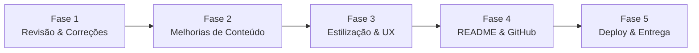

# 📋 Planejamento — Projeto React (Aula 08)

## 📖 Resumo da Atividade

> **Enunciado (PDF):** *"Desenvolvam uma aplicação React que utilize todos os conceitos estudados nesta aula, incluindo JSX, componentes, props, virtual dom, listas e renderização condicional. Criem um repositório público no GitHub e um README contendo a descrição, as funcionalidades, e os conceitos utilizados."*

## 🔎 Estado Atual do Projeto

O projeto já possui uma estrutura funcional com Vite + React 18 e **6 componentes** demonstrando cada conceito. Abaixo, o diagnóstico e as melhorias necessárias para entregar uma aplicação **completa, coesa e alinhada com todos os critérios** do enunciado.

---

## Fase 1 — Revisão & Correções Estruturais

> [!IMPORTANT]
> Garantir que a base do projeto esteja sólida antes de adicionar funcionalidades.

- [ ] **1.1** Verificar se `npm install` e `npm run dev` executam sem erros
- [ ] **1.2** Corrigir key duplicada em `ListasKeys.jsx` — atualmente usa o nome da fruta como key, o que causa problemas se o usuário adicionar frutas repetidas. Usar `id` único (ex.: `crypto.randomUUID()` ou contador incremental)
- [ ] **1.3** Validar que todos os 6 componentes renderizam corretamente e a navegação (cards → detalhe → voltar) funciona sem bugs
- [ ] **1.4** Confirmar que não há warnings no console do navegador (React StrictMode)
- [ ] **1.5** Revisar imports e remover dependências não utilizadas

---

## Fase 2 — Melhorias de Conteúdo dos Componentes

> [!NOTE]
> Cada componente deve demonstrar claramente o conceito da aula. Aqui enriquecemos os exemplos com base no conteúdo do PDF.

### 2.1 — JSX (`JSX.jsx`)
- [ ] **2.1.1** Adicionar exemplo mostrando diferenças entre JSX e HTML (`className` vs `class`, `htmlFor` vs `for`, tags auto-fechadas)
- [ ] **2.1.2** Incluir exemplo de expressão JavaScript dentro de JSX (operação aritmética, ex.: `{10 + 5}`)
- [ ] **2.1.3** Demonstrar uso de Fragment (`<>...</>`) como elemento raiz

### 2.2 — Componentes (`Componentes.jsx`)
- [ ] **2.2.1** Criar pelo menos 3 sub-componentes (ex.: `Cabecalho`, `Conteudo`, `Rodape`) para demonstrar composição e árvore de componentes
- [ ] **2.2.2** Adicionar representação visual da árvore de componentes (como o PDF mostra: `App → Cabecalho, Conteudo, Rodape`)
- [ ] **2.2.3** Demonstrar reutilização de componente (mesmo componente usado múltiplas vezes com dados diferentes)

### 2.3 — Props (`Props.jsx`)
- [ ] **2.3.1** Usar desestruturação de props (`{ titulo, descricao }`) no componente `Cartao` em vez de `props.titulo`
- [ ] **2.3.2** Demonstrar passagem de diferentes tipos de props: string, número, booleano, array
- [ ] **2.3.3** Adicionar exemplo de props com valor padrão (default props)
- [ ] **2.3.4** Incluir exemplo visual do fluxo pai → filho

### 2.4 — Virtual DOM (`VirtualDOM.jsx`)
- [ ] **2.4.1** Adicionar explicação textual sobre o processo de reconciliação (Mudança → Renderização → Reconciliação → Atualização)
- [ ] **2.4.2** Melhorar a visualização com destaque visual (ex.: highlight amarelo no nó alterado no Virtual DOM, verde no nó atualizado no DOM real)
- [ ] **2.4.3** Incluir um diagrama ou passo-a-passo visual do ciclo de atualização

### 2.5 — Listas e Keys (`ListasKeys.jsx`)
- [ ] **2.5.1** Corrigir sistema de keys (usar IDs únicos em vez de nome da fruta)
- [ ] **2.5.2** Adicionar exemplo com `filter()` — ex.: filtrar frutas por letra inicial ou por critério
- [ ] **2.5.3** Adicionar exemplo usando array de objetos com id (conforme PDF: `{ id: 101, nome: "Ana" }`)
- [ ] **2.5.4** Demonstrar uso de `map()` e `filter()` combinados

### 2.6 — Renderização Condicional (`RenderizacaoCondicional.jsx`)
- [ ] **2.6.1** Adicionar exemplo com `if/return` antecipado (early return, como o `MensagemAcesso` do PDF)
- [ ] **2.6.2** Adicionar exemplo de renderização condicional com lista vazia ("Nenhum resultado encontrado")
- [ ] **2.6.3** Demonstrar estado de "carregamento" com operador ternário (como o `ResultadoBusca` do PDF)
- [ ] **2.6.4** Incluir demonstração do operador `&&` (já existente, verificar se está claro)

---

## Fase 3 — Estilização & Experiência do Usuário

> [!TIP]
> Uma boa apresentação visual reforça a qualidade do projeto na avaliação.

- [ ] **3.1** Adicionar um cabeçalho/header na página principal com título "React Lab" e subtítulo
- [ ] **3.2** Adicionar um rodapé/footer com créditos (nome do aluno, disciplina, professor)
- [ ] **3.3** Melhorar responsividade — testar em mobile (320px) e tablet (768px)
- [ ] **3.4** Adicionar transições suaves nas interações (hover nos cards, animações ao trocar de página)
- [ ] **3.5** Garantir contraste de cores acessível (WCAG AA)
- [ ] **3.6** Adicionar favicon personalizado ao projeto

---

## Fase 4 — README e Repositório GitHub

> [!IMPORTANT]
> O enunciado exige explicitamente: "README contendo a descrição, as funcionalidades, e os conceitos utilizados."

- [ ] **4.1** Reescrever o `README.md` com as seguintes seções:
  - [ ] **4.1.1** 📝 Descrição — o que é o projeto e qual seu propósito
  - [ ] **4.1.2** 🚀 Funcionalidades — lista das funcionalidades interativas de cada conceito
  - [ ] **4.1.3** 📚 Conceitos Utilizados — explicação breve de cada conceito React aplicado:
    - JSX
    - Componentes
    - Props
    - Virtual DOM
    - Listas e Keys
    - Renderização Condicional
  - [ ] **4.1.4** 🛠️ Tecnologias — React 18, Vite, JavaScript ES6+
  - [ ] **4.1.5** ▶️ Como executar — instruções de `npm install` e `npm run dev`
  - [ ] **4.1.6** 📂 Estrutura do projeto — árvore de pastas e arquivos
  - [ ] **4.1.7** 👤 Autor — nome do aluno
- [ ] **4.2** Garantir que o repositório está **público** no GitHub
- [ ] **4.3** Fazer commits organizados e descritivos (não um único commit gigante)
- [ ] **4.4** Adicionar `.gitignore` adequado (já existe, verificar se `node_modules` e `dist` estão inclusos)

---

## Fase 5 — Build, Deploy e Entrega Final

- [ ] **5.1** Executar `npm run build` e verificar se o build produz sem erros
- [ ] **5.2** Testar o build localmente com `npm run preview`
- [ ] **5.3** *(Opcional)* Deploy na Vercel ou GitHub Pages para ter um link público da aplicação
- [ ] **5.4** Se deploy feito, adicionar link da aplicação no README
- [ ] **5.5** Push final para o GitHub
- [ ] **5.6** Verificar que o repositório público está acessível e o README renderiza corretamente

---

## 📊 Resumo de Progresso

| Fase | Descrição | Itens | Status |
|------|-----------|-------|--------|
| 1 | Revisão & Correções | 5 | ⬜ Pendente |
| 2 | Melhorias de Conteúdo | 17 | ⬜ Pendente |
| 3 | Estilização & UX | 6 | ⬜ Pendente |
| 4 | README & GitHub | 11 | ⬜ Pendente |
| 5 | Deploy & Entrega | 6 | ⬜ Pendente |
| **Total** | | **45 itens** | |

> [!TIP]
> Recomendação de tempo: Fases 1-2 primeiro (código funcional), depois Fase 3 (visual), e por último Fases 4-5 (documentação e entrega). Faça commits ao final de cada fase.
